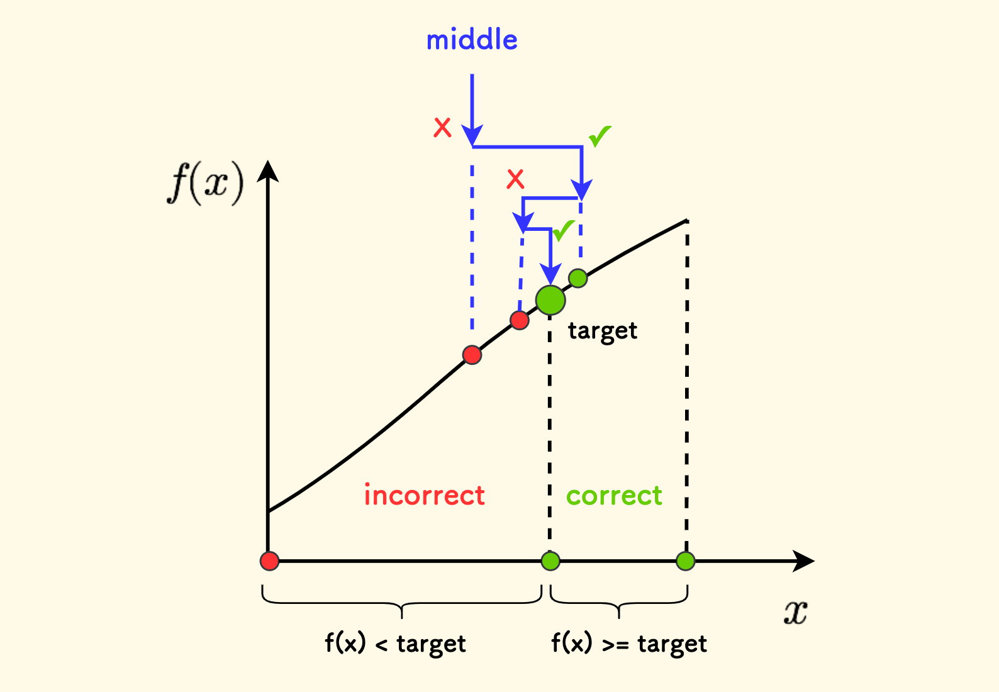
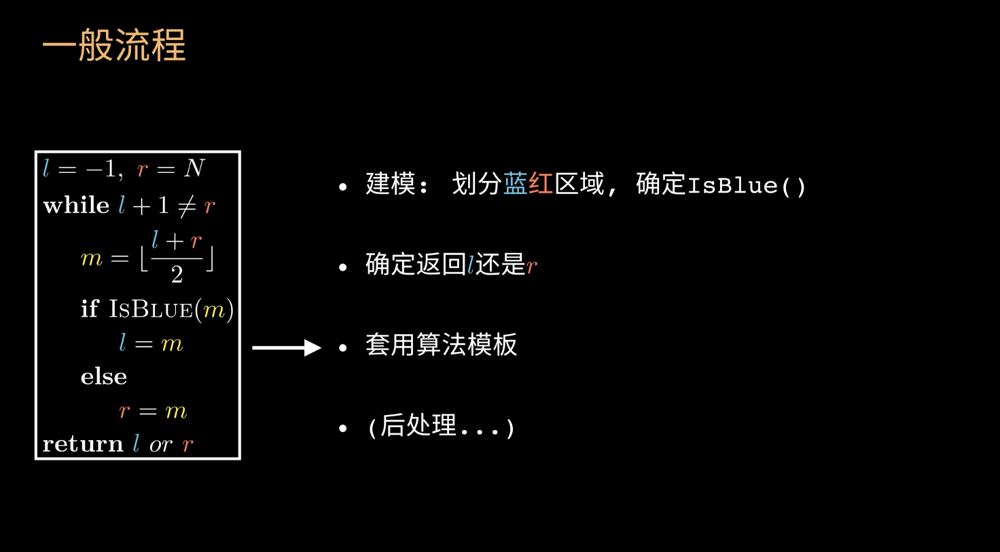
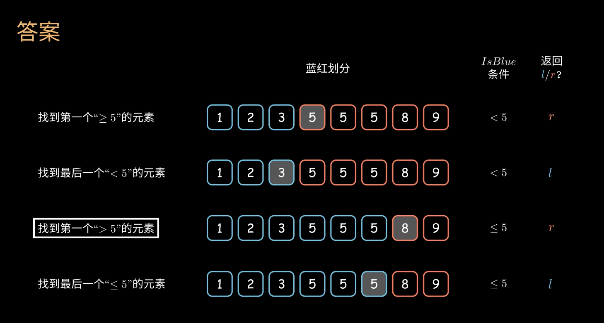

# 二分查找

## 1. 二段性的理解

二分的核心是：**每次缩小约一半搜索范围，同时保证所求答案或至少一个解仍被保留**。对于寻找分界点的二分，关键条件是"**二段性**"：

> **在当前可行区间上，某个性质呈现"前一半满足、后一半不满足"（或反之）的分布，就可以二分找分界点。**

换句话说：把所有候选答案排成一行，左边一段满足某性质、右边一段不满足，二分能 O(log n) 定位边界。

**数组数值单调可以帮助构造二段性**：在非递减数组中找 target 的左界，取条件 `nums[i] >= target`，判定结果就是"左侧不满足 / 右侧满足"。数组数值不必整体单调，但要使用红蓝染色找分界点，就必须证明判定结果形成左右两段，例如无重复元素的旋转数组找最小值。

**并非所有二分题都在找全局分界点**：LC162 允许多个峰，`nums[i] < nums[i+1]` 的判定结果可以反复变化；它依靠"每次保留至少一个峰"的区间不变量，详见 §5.3。

**为什么是 O(log n)**：找分界点时，每轮将 `mid` 判定为蓝或红，使尚待判定的开区间规模约减半；已知端点仍可能是最终返回值。重复约 `log₂(n)` 轮即可确定边界，因此时间为 `O(log n)`（n = 10⁹ 时仅需约 30 次比较）。LC162 则每次保留约半个含峰区间，同样是 `O(log n)`。



## 2. 何时使用二分查找

题目出现下列特征时考虑二分：

+ **具备二段性的数据**：有序数组是最常见形式；旋转数组、单峰数组通过适当染色也可二分。其他场景需要另外证明缩区间后仍保留解，不能仅凭模板套用。
+ **要求 O(log n) 效率**：题目明确对查找效率有要求，且数据可排序或具二段性。
+ **查找特定元素或边界**：找 target、找最左/最右出现位置、第一个 ≥ target 的位置（力扣 704、34、35）。
+ **查找峰值 / 谷值**：LC162 允许多峰，可比较 `nums[mid]` 与 `nums[mid+1]`，保留至少含一个峰的半边；不能把其坡度判定当成全局二段性。若是单峰连续函数，可考虑三分查找；仅有连续性不保证三分适用。
+ **猜数游戏**：每次猜一个值，根据反馈缩小范围（力扣 374）。
+ **旋转数组查找**：将数组分成两段有序子段，借助分段性质二分（力扣 33、153）。
+ **二维矩阵查找**：行优先有序矩阵当作一维二分（力扣 74）；行列分别有序的矩阵从右上 / 左下"剥洋葱"（力扣 240）。
+ **"最大的最小 / 最小的最大"类最优化问题**：典型的**答案二分**信号（详见后文）。

> **如何识别隐藏的二分题**：题目要求一个数值答案，且"答案越大越…，越小越…"具有单调性 → 大概率能写成 `check(x)` + 二分。即使题面没出现"二分"或"有序"字样，只要满足这个特征就值得一试。

## 3. 二分模板（开区间红蓝染色法）

`IsBlue(i)` 是用户根据题意定义的判定函数，表示"位置 `i` 是否在蓝色区"，下一节详解如何构造。

```cpp
// 待查询区间。二分查找完成后，划分为左蓝右红
std::vector<int> data{2, 3, 4, 5, 6, 7};
int l = -1, r = data.size();
// (l, r)
while (l + 1 < r) {
    int mid = l + (r - l) / 2;
    if (IsBlue(mid)) {
        l = mid;
    } else {
        r = mid;
    }
}
return l; // 或 return r，按 IsBlue 定义和题意决定
```

**要点**：

+ **越界哨兵**：开区间 `(l, r)` 取 `l = -1`（**必蓝**，虚拟左哨兵）、`r = N`（**必红**，虚拟右哨兵）——它们不是合法下标，但循环不变式把它们当作"已染好色"的端点。**答案二分**中 `l, r` 同样取必蓝 / 必红的值（与数组长度无关）。
+ **循环条件 `l + 1 < r`**：开区间内有元素就继续，如 `(4, 6)` 含 `5` 要进；`(4, 5)` 为空，跳出。
+ **循环不变式**：`l` 及其左侧已知为蓝，`r` 及其右侧已知为红，`(l, r)` 内仍待判定；循环中不能断言 `l`、`r` 已是全局最后一个蓝、第一个红。结束时 `l + 1 == r`，才能确定它们分别是最后一个蓝、第一个红——**不必纠结 `mid±1`**，赋值永远是 `l = mid` 或 `r = mid`。
+ **防溢出**：`mid = l + (r - l) / 2`，避免 `l + r` 溢出。
+ **循环内 `mid` 始终合法**：由 `l + 1 < r` 和 `mid = l + (r - l) / 2` 可推出 `l < mid < r`；结合 `l >= -1`、`r <= n`，得 `mid ∈ [0, n-1]`。**循环体内访问 `nums[mid]` 永远不越界，无需额外判空**。注意区分：循环结束后的 `l`/`r` 可能越界（如 `r == n` 表示 target 比所有元素都大），仍需后处理。
+ **解题流程**：（1）划分蓝红，写 `IsBlue`；（2）确定返回 `l` 还是 `r`；（3）套模板；（4）后处理（**判断返回的下标是否合法**）。



### 3.1 端到端示范：力扣 34（在排序数组中查找元素的第一个和最后一个位置）

> 给定升序数组 `nums` 和 `target`，返回 target 第一次和最后一次出现的下标，不存在返回 `[-1, -1]`。

这是把上面的模板**完整跑一遍**的最佳例题——同一模板调用两次，分别找左右边界。下图直观展示了"找第一个 ≥ X / 最后一个 < X / 第一个 > X / 最后一个 ≤ X"四种边界查询如何通过 `IsBlue` 条件 + 选择返回 `l`/`r` 来覆盖：



```cpp
class Solution {
public:
    vector<int> searchRange(vector<int>& nums, int target) {
        int n = nums.size();
        if (n == 0) return {-1, -1};

        // —— 找左边界：第一个 >= target 的位置 ——
        // 蓝（左）：nums[i] < target，红（右）：nums[i] >= target
        // 第一个红就是左边界，所以返回 r
        auto leftBound = [&]() {
            int l = -1, r = n;                     // 越界哨兵
            while (l + 1 < r) {
                int mid = l + (r - l) / 2;
                if (nums[mid] < target) l = mid;   // mid 在蓝色区
                else                    r = mid;   // mid 在红色区
            }
            return r;  // 第一个红
        };

        // —— 找右边界：最后一个 <= target 的位置 ——
        // 蓝（左）：nums[i] <= target，红（右）：nums[i] > target
        // 最后一个蓝就是右边界，所以返回 l
        auto rightBound = [&]() {
            int l = -1, r = n;
            while (l + 1 < r) {
                int mid = l + (r - l) / 2;
                if (nums[mid] <= target) l = mid;  // mid 在蓝色区
                else                     r = mid;  // mid 在红色区
            }
            return l;  // 最后一个蓝
        };

        int L = leftBound(), R = rightBound();
        // 后处理：必须显式判断 target 是否真的存在
        if (L > R) return {-1, -1};                // 区间为空 → 不存在
        return {L, R};
    }
};
```

**学习要点**：
1. 同一份模板代码不变，**只换 `IsBlue` 的定义**就能解不同问题——这就是红蓝染色法的威力。
2. **返回 `l` 还是 `r` 由"要最后一个蓝还是第一个红"决定**，不要硬记。
3. **后处理必不可少**：二分结束后返回的下标可能越界、可能不是 target，**必须显式判断**才能用。

## 4. 两类二分：下标二分 vs 答案二分

二分在实际题目中分两大类，**第二类才是面试 / 竞赛中最高频的套路**：

| 维度 | 下标二分 | 答案二分（值域二分） |
|------|---------|----------------------|
| **二分对象** | 数组下标 `[0, n-1]` | 答案的取值范围 `[ans_min, ans_max]` |
| **数据要求** | 查边界需具备二段性；LC162 等找峰题另证保留解的不变量 | 可行性判定随候选答案单调变化 |
| **核心难点** | 边界处理、`IsBlue` 写对 | **构造 `check` + 判断单调性方向** |
| **`check` 内容** | `nums[mid]` 与参照物比较 | 贪心 / 模拟 / DP |
| **时间复杂度** | `O(log n)` | `O(log V · T_check)`，V 为值域大小 |
| **关键词识别** | "找元素 / 第一个 ≥ X / 旋转数组" | "**最大的最小 / 最小的最大**"、"X 内能否完成"、"至少 / 至多多少" |
| **典型题目** | 704、34、35、162、153、33 | 875、1011、410、378、4 |

## 5. 如何构造二段性

使用红蓝染色模板前，需要先证明二段性。下面主要介绍如何构造左右两段；§5.3 的 LC162 则单独说明不依赖全局二段性的保留峰证明。

### 5.1 场景一：有序数组找 target 的左边界（完整代码）

> 在非递减数组 `nums` 中，找第一个等于 `target` 的位置（力扣 34 左半题，也是 `lower_bound`）。

**染色**：以"是否 `< target`"为标准
+ 蓝（左侧）：`nums[i] < target`
+ 红（右侧）：`nums[i] >= target`

要"第一个 ≥ target 的位置"，即"**第一个红**" → 返回 `r`。

```cpp
int lowerBound(vector<int>& nums, int target) {
    int n = nums.size();
    int l = -1, r = n;
    while (l + 1 < r) {
        int mid = l + (r - l) / 2;
        if (nums[mid] < target) l = mid;
        else                    r = mid;
    }
    // 后处理：r 可能 == n（target 比所有元素都大），也可能 nums[r] != target
    return r;  // 调用者需自行判断是否合法
}
```

### 5.2 场景二：旋转数组找最小值（力扣 153）

> 数组原本升序，被旋转后变成 `[4,5,6,7,0,1,2]`，找最小值。

**关键观察**：拿 `nums[n-1]` 作参照，最小值左边都比它大，最小值及右边都不大于它。

```cpp
// 蓝：nums[i] > nums[n-1]，红：nums[i] <= nums[n-1]
// 要"第一个红"（最小值是分界点的右侧）→ 返回 r
int findMin(vector<int>& nums) {
    int n = nums.size();
    int l = -1, r = n;
    while (l + 1 < r) {
        int mid = l + (r - l) / 2;
        if (nums[mid] > nums[n - 1]) l = mid;
        else                          r = mid;
    }
    return nums[r];
}
```

> **进阶：力扣 33 — 旋转数组找 target**。33 比 153 难一档：先用 153 的方法找到旋转点 `p`，把数组拆成两段有序子数组 `[0, p)` 和 `[p, n)`，再判断 target 落在哪一段，对该段做普通二分。也可以一次二分内完成：每次根据 `mid` 与 `nums[0]`、`nums[n-1]` 的关系判断 mid 落在哪个有序段，再决定砍左半还是右半。

下面给出"两次二分"的完整代码——它把 33 拆成 153 + 普通二分两步，每步都套同一份开区间红蓝染色模板：

```cpp
// 力扣 33 — 旋转数组找 target，返回下标，找不到返回 -1
class Solution {
public:
    int search(vector<int>& nums, int target) {
        int n = nums.size();

        // —— 第一步：用 153 的方法找最小值下标 p（旋转点）——
        // 蓝：nums[i] > nums[n-1]，红：nums[i] <= nums[n-1]；要"第一个红" → 返回 r
        int l = -1, r = n;
        while (l + 1 < r) {
            int mid = l + (r - l) / 2;
            if (nums[mid] > nums[n - 1]) l = mid;
            else                          r = mid;
        }
        int p = r;  // 最小值下标；若数组未旋转，p = 0

        // —— 第二步：判断 target 落在哪段，对该段做 lower_bound ——
        int lo, hi;
        if (p > 0 && target <= nums[n - 1]) { lo = p,    hi = n; }      // 右段 [p, n)
        else                                 { lo = 0,    hi = p == 0 ? n : p; }  // 左段
        // 在 [lo, hi) 上找第一个 >= target 的位置
        int L = lo - 1, R = hi;
        while (L + 1 < R) {
            int mid = L + (R - L) / 2;
            if (nums[mid] < target) L = mid;
            else                    R = mid;
        }
        // 后处理：R 可能越界 / nums[R] != target
        if (R < hi && nums[R] == target) return R;
        return -1;
    }
};
```

> **进阶版（一次二分）**：每次根据 `nums[0] <= nums[mid]` 判断 mid 落在前段还是后段，再分类讨论 target 是否在 mid 同侧的有序区间内决定收缩方向。代码更短但分支多，初学者建议先掌握上面的"两次二分"版本。

### 5.3 场景三：多峰数组找任意峰值（力扣 162）

> [LC162 官方题意](https://leetcode.com/problems/find-peak-element/)：数组非空，相邻元素不相等，两端外视为 `-∞`；允许多个峰，返回任意一个严格大于相邻元素的峰值下标。

例如 `[1,2,1,3,5,6,4]` 的相邻走势为"升、降、升、升、升、降"，`nums[i] < nums[i+1]` 并不具有全局二段性。因此下面的代码不是找"第一个下降位置"，也不保证找到最左峰或最高峰。

**保留峰的不变量**：

+ 保持 `nums[l] < nums[l+1]`、`nums[r] > nums[r+1]`；`l = -1` 或 `r = n-1` 时，使用题目约定的边界 `-∞`，代码不实际访问越界元素。
+ 因为左边界处上升、右边界处下降，所以 `(l, r]` 中至少包含一个原数组的峰。
+ 若 `nums[mid] < nums[mid+1]`，令 `l = mid`，保留的 `(mid, r]` 仍满足上述边界关系；否则相邻不等意味着 `nums[mid] > nums[mid+1]`，令 `r = mid`，保留的 `(l, mid]` 仍满足关系。
+ 结束时 `l + 1 == r`，`nums[r]` 大于左右邻居，因此 `r` 就是一个峰。这里的 `(l, r]` 是峰的候选范围，不要与 §3 中待判定颜色的开区间 `(l, r)` 混淆。

```cpp
// 比较坡度并保留至少一个峰，不要求坡度判定具有全局二段性
int findPeak(vector<int>& nums) {
    int n = nums.size();
    // 初始边界：nums[-1] < nums[0]，nums[n-1] > nums[n]（两端外为 -∞）
    int l = -1, r = n - 1;
    while (l + 1 < r) {
        int mid = l + (r - l) / 2;
        if (nums[mid] < nums[mid + 1]) l = mid;
        else                            r = mid;
    }
    return r;
}
```

**多峰自测**：上述示例中 `(l,r)` 依次为 `(-1,6) → (2,6) → (4,6) → (4,5)`，返回下标 `5`；第一个下降位置却是下标 `1`，说明不能用"找第一个红"解释。单元素、严格递增和严格递减数组也都满足本题条件，时间为 `O(log n)`、额外空间为 `O(1)`。

### 5.4 场景四：答案二分（构造"可行性"的二段性）

> 力扣 875：珂珂吃香蕉。猜一个吃速 `k`，问最小的 `k` 多大时能在 `h` 小时内吃完。吃速越大越容易在规定时间内吃完——可行性随 `k` 单调。

这里 `check(k)` 是用户写的"可行性判定函数"——给定一个候选答案 `k`，判断它是否满足题目要求（详见下一节"答案二分详解"）。

```cpp
// 蓝：check(k) == false（不可行），红：check(k) == true（可行）
// 要"第一个红"（最小可行 k）→ 返回 r
auto IsBlue = [&](int k) { return !check(k); };
```

### 5.5 构造二段性的通用流程

1. **找参照物**：先选好参照物（target、`nums[n-1]`、`check(x)` 等），并证明判定结果形成左右两段；LC162 的多峰情形按 §5.3 单独证明。
2. **画一条数轴**：把所有候选下标 / 答案值排开，左边一段标蓝，右边一段标红。
3. **写 IsBlue**：用一行代码描述"什么样的 `i`（或 `x`）在蓝色区"。
4. **决定返回 l 还是 r**：要"最后一个蓝"返回 `l`，要"第一个红"返回 `r`。
5. **后处理**：检查返回的下标是否越界 / 是否符合题目要求。

> 写 `IsBlue` 之前先在草稿纸上画出数轴和染色，能避免大部分边界错误。

## 6. 答案二分（值域二分）详解

### 6.1 识别与三步套路

看到题目时问自己三个问题：（1）答案是数值吗？（2）有取值范围吗？（3）给定 `x` 能高效验证可行性吗？三个全是"是"时可以考虑答案二分，但仍必须证明 `check(x)` 随 `x` 单调变化。

固定三步：
1. **确定已知颜色的端点 `l`、`r`**：循环只检查尚未判定的 `(l, r)`，保持 `l` 必蓝、`r` 必红。端点可以是题意允许的虚拟哨兵，但最终返回的可行端点也可能就是真实答案，不能把答案范围一律写成开区间。
   - **找最小可行**（蓝 = `!check`、红 = `check`，返回 `r`）：`l` 取**必不可行**的值（通常 = 最小合法答案 - 1，如 875 的 `l = 0`、1011 / 410 的 `l = max - 1`）；`r` 取**必然可行**的值（如所有元素之和、`INT_MAX`）。
   - **找最大可行**（蓝 = `check`、红 = `!check`，返回 `l`）：方向相反——`l` 取**显然可行**的最小值（如 1552 的 `l = 0`）；`r` 取**必然不可行**的值（如最大可能值 + 1）。
   - **答案范围**：找最小可行时，`l` 不可行、`r` 可行，答案在 **`(l, r]`**；找最大可行时，`l` 可行、`r` 不可行，答案在 **`[l, r)`**。`(l, r)` 只是尚待检查的候选值；端点取宽一些也必须满足上述可行性关系，并注意数值溢出。
2. **写 `check(x)`**：判断"答案为 `x` 时是否可行"，内部通常是贪心或模拟，偶尔是 DP。
3. **二分**：利用 `check` 的单调性收敛。

### 6.2 check 的三种常见模式

#### 6.2.1 模式一：贪心 check（最常见）

**例题：力扣 875 — 爱吃香蕉的珂珂**

> 给定 piles（每堆香蕉数量）和 h（小时数），找最小吃速 k，使 h 小时内吃完所有香蕉。每小时只能吃一堆，吃不完的剩余下小时继续，但不会跨堆。

```cpp
class Solution {
public:
    int minEatingSpeed(vector<int>& piles, int h) {
        // 1. 值域哨兵：l = 0 必蓝（吃速 0 不可能吃完），r = max(piles) 必红（每堆 1 小时吃完）
        int l = 0;
        int r = *max_element(piles.begin(), piles.end());

        // 2. check：吃速 k 下能否在 h 小时内吃完（贪心：累加每堆耗时）
        auto check = [&](int k) -> bool {
            long long hours = 0;  // 注意溢出！piles 可能很大
            for (int p : piles) {
                hours += (p + k - 1) / k;  // 向上取整
            }
            return hours <= h;
        };

        // 3. 开区间红蓝染色：蓝 = 不可行，红 = 可行；要"第一个红"(最小可行) → 返回 r
        while (l + 1 < r) {
            int mid = l + (r - l) / 2;
            if (!check(mid)) l = mid;   // 不可行 → 蓝
            else             r = mid;   // 可行   → 红
        }
        return r;
    }
};
```

**单调性分析**：`k` 越大，每堆耗时越少，总耗时越少 → 越容易满足 `hours <= h`。

**端点自测**：按 [LC875 官方题意](https://leetcode.com/problems/koko-eating-bananas/)，`piles = [7]`、`h = 1` 时最小吃速为 `7`。初始 `l = 0`、`r = 7`，答案恰好等于 `r`，因此最小可行答案范围是 `(l, r]`。题目保证 `h >= piles.size()`，所以 `r = max(piles)` 确实可行；`l = 0` 只作不可行哨兵，不会传入含除法的 `check`。

#### 6.2.2 模式二：模拟 check

**例题：力扣 1011 — 在 D 天内送达包裹的能力**

> 给定包裹重量数组 weights 和天数 D，找最小载重 capacity，使能按顺序在 D 天内送完。

```cpp
int shipWithinDays(vector<int>& weights, int D) {
    // 1. 值域哨兵：
    //    l = max(weights) - 1 必蓝（载重小于单个最大包裹一定装不下）
    //    r = sum(weights)     必红（一天送完所有包裹一定可行）
    int l = *max_element(weights.begin(), weights.end()) - 1;
    int r = accumulate(weights.begin(), weights.end(), 0);

    // 2. check：模拟装船
    auto check = [&](int cap) -> bool {
        int days = 1, load = 0;
        for (int w : weights) {
            if (load + w > cap) { days++; load = w; }
            else                  load += w;
        }
        return days <= D;
    };

    // 3. 开区间红蓝染色：蓝 = 不可行，红 = 可行；要"第一个红" → 返回 r
    while (l + 1 < r) {
        int mid = l + (r - l) / 2;
        if (!check(mid)) l = mid;
        else             r = mid;
    }
    return r;
}
```

#### 6.2.3 模式三：贪心 / DP check（较难）

**例题：力扣 410 — 分割数组的最大值**

> 把非负整数数组分成 m 个非空连续子数组，使各子数组和的最大值最小。

```cpp
int splitArray(vector<int>& nums, int m) {
    // 1. 值域哨兵：
    //    l = max(nums) - 1 必蓝（上限小于单个最大值，单元素都装不下）
    //    r = sum(nums)     必红（整段一段，必可行）
    long long l = (long long)*max_element(nums.begin(), nums.end()) - 1;
    long long r = accumulate(nums.begin(), nums.end(), 0LL);

    // 2. check：当每段和上限为 cap 时，贪心切分能否切成 <= m 段
    auto check = [&](long long cap) -> bool {
        int cnt = 1; long long sum = 0;
        for (int x : nums) {
            if (sum + x > cap) { cnt++; sum = x; }
            else                 sum += x;
        }
        return cnt <= m;
    };

    // 3. 开区间红蓝染色：蓝 = 不可行，红 = 可行；要"第一个红" → 返回 r
    while (l + 1 < r) {
        long long mid = l + (r - l) / 2;
        if (!check(mid)) l = mid;
        else             r = mid;
    }
    return (int)r;
}
```

> 410 也可纯 DP（O(n²·m)），答案二分（O(n·log V)）更优。需要 DP check 的题相对少见，但思想一致：把"判断可行性"包装成函数即可。

### 6.3 判断单调性方向

写完 `check` 后问自己：**`x` 越大，`check(x)` 越容易为 true 还是 false？**

+ **越大越容易 true**（吃速、载重、分段上限）→ 找**最小**可行 → 蓝 = `!check`、红 = `check`，返回 `r`（第一个红）。
+ **越大越容易 false**（限制人数、限制次数、间距上限）→ 找**最大**可行 → 蓝 = `check`、红 = `!check`，返回 `l`（最后一个蓝）。

> **小技巧**：开区间红蓝染色法天然兼容两种方向——只需把 `IsBlue` 的定义换一下（一个取 `!check`，一个取 `check`），模板代码完全相同。可代入边界值验证：左端点 `l` 应为蓝、右端点 `r` 应为红；虚拟哨兵按定义赋色，不要求实际执行判定函数。

#### 6.3.1 "找最大可行"完整代码 — 力扣 1552 两球之间的磁力

> 在 `position` 中放 m 个球，使任意两球之间最小磁力（距离）尽可能大。

`d` 越大，能放下的球数越少 → "可放下 m 个球"随 `d` 越大越容易 false → 找**最大**可行 `d`。

这是开区间红蓝染色法处理"找最大可行"的标准范式：**让 `IsBlue = check`（可行），返回最后一个蓝即为最大可行**。

```cpp
int maxDistance(vector<int>& position, int m) {
    sort(position.begin(), position.end());
    int n = position.size();

    auto check = [&](int d) {  // 间距 >= d 时能否放下 m 个球
        int cnt = 1, prev = position[0];
        for (int i = 1; i < n; i++) {
            if (position[i] - prev >= d) { cnt++; prev = position[i]; }
        }
        return cnt >= m;
    };

    // 值域哨兵：
    //   l = 0 必蓝（将可行性扩展到距离 0 时，仍能放下 m 个球；作为已知可行下界）
    //   r = max_gap + 1 必红（间距比总跨度还大，必不可行）
    int l = 0, r = position.back() - position.front() + 1;

    // 开区间红蓝染色：蓝 = 可行（IsBlue = check），红 = 不可行；
    // 要"最后一个蓝"(最大可行) → 返回 l
    while (l + 1 < r) {
        int mid = l + (r - l) / 2;
        if (check(mid)) l = mid;   // 可行 → 蓝（往大试）
        else            r = mid;   // 不可行 → 红
    }
    return l;
}
```

### 6.4 复杂度分析

时间 `O(log V · T_check)`，V 是值域大小，T_check 是单次 check 复杂度；空间通常 `O(1)`（DP check 例外）。所以 **check 必须保持 O(n) 或 O(n log n)**，否则总复杂度过高。

## 7. 其它常用模板

### 7.1 闭区间 [l, r] / 左闭右开 [l, r)

同一问题可以用不同区间定义实现，理解互相对应有助于读懂他人代码。

**闭区间 `[l, r]`**：
```cpp
// 查找第一个 >= target 的下标（lower_bound 语义）
int l = 0, r = n - 1, ans = n;  // ans 作为"找不到"的兜底
while (l <= r) {
    int mid = l + (r - l) / 2;
    if (nums[mid] >= target) { ans = mid; r = mid - 1; }
    else                       l = mid + 1;
}
return ans;
```

**左闭右开 `[l, r)`**：
```cpp
int l = 0, r = n;
while (l < r) {
    int mid = l + (r - l) / 2;
    if (nums[mid] >= target) r = mid;
    else                     l = mid + 1;
}
return l; // 等于 n 表示不存在
```

加上节 3 的开区间红蓝染色，三种写法完全等价，按个人习惯选择，但**同一份代码内风格应统一**。

### 7.2 猜数游戏 — 力扣 374

最直观的二分入门题：系统选一个 1~n 之间的数，每次猜一个，`guess(num)` 返回 -1（你猜大了）/ 1（你猜小了）/ 0（猜对了）。

```cpp
int guessNumber(int n) {
    int l = 1, r = n;
    while (l <= r) {
        int mid = l + (r - l) / 2;
        int res = guess(mid);
        if (res == 0)      return mid;
        else if (res < 0)  r = mid - 1;  // 猜大了，往小猜
        else               l = mid + 1;  // 猜小了，往大猜
    }
    return -1;  // 题目保证有解，实际不会到这里
}
```

### 7.3 浮点二分

实数域上用循环次数控制精度（不能用 `l < r`，会因浮点误差死循环）。

```cpp
// 求 sqrt(x)，精度 1e-7
double mySqrt(double x) {
    double l = 0, r = max(1.0, x);
    for (int i = 0; i < 100; i++) {  // 100 次足够 1e-30 精度
        double mid = l + (r - l) / 2;
        if (mid * mid <= x) l = mid;
        else                r = mid;
    }
    return l;
}
```

### 7.4 二维矩阵二分

**力扣 74**（行优先有序，整体可视为一维升序数组）：把 `idx` 映射到 `(idx / cols, idx % cols)`，套用一维二分。

**力扣 240**（每行升序、每列升序，但整体非升序）：从**右上角**开始，比 target 大就左移、小就下移，每步排除一行或一列，O(m + n)。这不是严格二分，但常一起讲。

```cpp
// 力扣 240 剥洋葱
bool searchMatrix(vector<vector<int>>& mat, int target) {
    int i = 0, j = mat[0].size() - 1;
    while (i < mat.size() && j >= 0) {
        if (mat[i][j] == target) return true;
        else if (mat[i][j] > target) j--;
        else                         i++;
    }
    return false;
}
```

## 8. C++ STL 对应

| 函数 | 语义 | 红蓝染色对应 |
|------|------|-------------|
| `std::lower_bound(begin, end, x)` | 第一个 `>= x` 的位置 | `IsBlue(i) = (a[i] < x)`，返回 `r` |
| `std::upper_bound(begin, end, x)` | 第一个 `> x` 的位置 | `IsBlue(i) = (a[i] <= x)`，返回 `r` |
| `std::equal_range(begin, end, x)` | 返回 `[lower, upper)` 区间 | 两次二分 |
| `std::binary_search(begin, end, x)` | 仅判断是否存在 | —— |
| `std::partition_point(begin, end, pred)` | 谓词从 true 切换到 false 的分界 | **红蓝染色法的标准库形式** |

注意：返回迭代器，需自行 `- begin` 转下标，并判断是否等于 `end`。`std::set` / `std::map` 应用**成员函数** `lower_bound`（O(log n)），外部函数对它们退化为 O(n)。

## 9. 常见陷阱

1. **`mid` 计算溢出**：`(l + r) / 2` 在 `l, r` 接近 `INT_MAX` 时溢出，永远写 `l + (r - l) / 2`。
2. **`check` 内累加溢出**：累加 / 计数容易爆 int，用 `long long` 兜底（如 875 的 `hours`、410 的 `sum`）。
3. **死循环**：闭区间 `while(l < r)` 写法中若 `l = mid` 且 `mid` 下取整，`r - l == 1` 时死循环，需上取整 `mid = l + (r - l + 1) / 2`。**开区间红蓝染色法（`while(l + 1 < r)`）天然规避此坑**，赋值永远是 `l = mid` 或 `r = mid`，无需考虑取整方向。
4. **后处理遗漏**：返回的下标可能越界、可能不等于 target——**必须显式判断**再访问。
5. **二段性方向搞反**：写 `IsBlue` 前画数轴；用边界值验证 **`l` 必蓝、`r` 必红**（与所选 `IsBlue` 定义保持一致）——找最小可行时 `IsBlue = !check`，故 `check(l) = false / check(r) = true`；找最大可行时 `IsBlue = check`，故 `check(l) = true / check(r) = false`。
6. **答案二分哨兵取错**：`l` 必须必蓝、`r` 必须必红，不能拍脑袋写定值（如珂珂题写 `r = 1000`）；最小可行答案须在 `(l,r]`，最大可行答案须在 `[l,r)`，超出相应范围会漏答案。
7. **check 复杂度过高**：总复杂度 `O(log V · T_check)`，`check` 应保持 O(n) 或 O(n log n)。
8. **浮点二分精度**：实数二分别用 `l < r`，应固定迭代次数（如 100 次）或用 `r - l > eps`。

## 10. 与其他算法的结合

- **二分 + 贪心**：几乎所有"答案二分"的 `check` 都是贪心。
- **二分 + 前缀和 / 双指针**：力扣 209（长度最小子数组）。
- **二分答案 + DP 判定**：力扣 410（分割数组的最大值）。
- **有序容器二分**：`std::set::lower_bound`、`std::map::lower_bound`。
- **维护单调序列后二分**：LIS 的 O(n log n) 解法在 `tails` 数组上 `lower_bound`。

## 11. 推荐练习题

| 难度 | 题号 | 标题 | 要点 |
|------|------|------|------|
| 入门 | 704 | 二分查找 | 模板题，验证模板是否写对 |
| 入门 | 374 | 猜数字大小 | 最直观的二分入门，`guess()` 即比较 |
| 入门 | 35 | 搜索插入位置 | `lower_bound` 语义 |
| 入门 | 34 | 查找元素的第一个和最后一个位置 | 同模板调用两次（左右边界） |
| 入门 | 69 | x 的平方根 | 答案二分入门，注意溢出 |
| 入门 | 278 | 第一个错误的版本 | 经典二段性，`isBadVersion` 即 check |
| 进阶 | 162 | 寻找峰值 | 比较 `nums[mid]` 与 `nums[mid+1]`，每次保留至少一个峰；允许多峰 |
| 进阶 | 153 | 寻找旋转排序数组中的最小值 | 用 `nums[n-1]` 染色 |
| 进阶 | 154 | 寻找旋转排序数组中的最小值 II | 153 含重复元素，最坏退化到 O(n) |
| 进阶 | 33  | 搜索旋转排序数组 | 旋转数组找 target，判 mid 落在哪段 |
| 进阶 | 81  | 搜索旋转排序数组 II | 33 含重复元素 |
| 进阶 | 74  | 搜索二维矩阵 | 行优先 → 一维二分 |
| 进阶 | 240 | 搜索二维矩阵 II | 右上角剥洋葱，O(m+n) |
| 答案二分 | 875 | 爱吃香蕉的珂珂 | 入门，贪心 check |
| 答案二分 | 1011 | 在 D 天内送达包裹的能力 | 模拟 check（顺序装船） |
| 答案二分 | 410 | 分割数组的最大值 | 贪心切分 check，"最大值的最小化"经典题 |
| 答案二分 | 1552 | 两球之间的磁力 | "找最大可行"代表，间距越大球越少 |
| 答案二分 | 378 | 有序矩阵中第 K 小的元素 | 值域二分，统计 `<= mid` 的元素个数 |
| 答案二分 | 4 | 寻找两个正序数组的中位数 | 在较短数组的分割位置上二分，使两半元素数相等且左边都 ≤ 右边 |
| 拔高 | 1283 | 使结果不超过阈值的最小除数 | 答案二分模板 |
| 拔高 | 2141 | 同时运行 N 台电脑的最长时间 | 单调性方向是难点 |
| 拔高 | 2226 | 每个小孩最多能分到多少糖果 | 答案二分模板 |

> **学习路径建议**：
> 1. **第一遍**：读完节 1-3，做完入门 5 题（704、374、35、34、278），消化下标二分模板。
> 2. **第二遍**：读完节 4-5，做完进阶 5 题（162、153、33 等），区分构造二段性与保留峰的不变量。
> 3. **第三遍**：读完节 6（答案二分），**至少做 3 道答案二分题**（875、1011、410），否则 `check` 的感觉建立不起来。
> 4. **第四遍**：刷拔高题 + 矩阵题作为综合检验。

## 12. 一图速记

**下标二分：在数组里找位置**
```
+--------+--------+
|  BLUE  |  RED   |
+--------+--------+
         ^ 分界点
IsBlue(i) 看 nums[mid]
```

**答案二分：在值域里猜答案**
```
+--------+--------+
|  BAD   |   OK   |
+--------+--------+
         ^ 最小可行
check(x) 贪心 / 模拟
```

## 13. 参考视频
https://www.bilibili.com/video/BV1d54y1q7k7/?spm_id_from=333.1007.top_right_bar_window_history.content.click&vd_source=79c14e6eb4e17fa8f69cfb20c08ce512
