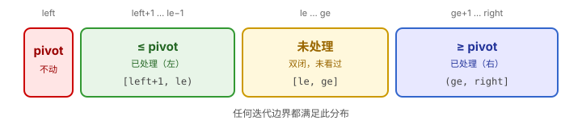

# 快速排序 QuickSort

## 1. 本质

> **快速排序的本质**：每次 Partition 让**一个元素**到达它在最终有序数组里的**正确位置**；对剩下的两段递归同样操作，所有元素就都就位了。

这一句概括了为什么快排"能工作"：

+ **每次 Partition 必有一个元素就位**：选一个 `pivot`，把数组重排成 `[≤ pivot | pivot | ≥ pivot]`。重排完成后，`pivot` 左边都不大于它、右边都不小于它——它已经站在最终位置上了。
+ **递归让所有元素就位**：对左右两段重复同样过程，直到子段长度 ≤ 1（天然有序）。

对比其他排序：

| 算法 | 核心机制 | 每轮"确定"什么 |
|------|---------|---------------|
| **快速排序** | Partition + 分治 | 让 1 个 pivot 就位 |
| 归并排序 | 分裂 + 合并 | 让两段已排序段合并出一段更长的有序段 |
| 选择排序 | 找最小放最前 | 让 1 个最小元素就位 |
| 插入排序 | 把当前元素插到前缀有序段 | 让前 i+1 个元素有序 |

时间 **O(n log n) 平均**，O(n²) 最坏（用随机 pivot 概率上规避）；空间 **O(log n)**（递归栈）。

## 2. 三个关键设计选择

写快排前先想清楚这三件事，后面的代码就是它们的产物：

+ **选 pivot 的位置**：最左 / 最右 / 随机 / 三数取中。**随机 pivot 是性价比最高的选择**——以期望意义规避最坏情况。
  + **本文把 pivot 放最左**：让 `[left+1, le)` 这个左已处理区从"空"开始向右扩张更自然。放最右等价但不变量边界要重写——这是设计选择，不是必然。
  + **随机 pivot 公式** `swap(nums[left], nums[left + rand() % (right - left + 1)])`：`right - left + 1` 是区间长度 → `rand() %` 取 `[0, len)` → 加 `left` 落到合法下标 `[left, right]` → 再 swap 到 `nums[left]`，让随机选中的元素就位。
+ **Partition 方案**：Hoare 双指针（左右夹击）/ Lomuto（单指针扫描）/ 三路（处理大量重复）。**本文主推 Hoare 双指针**——平均比较次数最少，配合严格比较还能均匀分散重复元素。
+ **如何避免退化**：① 随机 pivot；② 严格 `<`/`>` 让等于 pivot 的元素均匀分散两侧；③ 数据可能大量重复时考虑三路快排。

## 3. Partition 的循环不变量（核心！）

> **快排难写不是因为复杂，是因为细节多。** 把所有细节锚定到**一个**循环不变量上，就能从它机械推出每一行代码。

### 3.1 循环不变量

任何时刻、任何迭代边界，下面这张图始终成立：



**三句话锁死：**

1. `nums[left]` 是 pivot，整个 Partition 期间不动。
2. **已处理**：`[left+1, le)` 全部 ≤ pivot；`(ge, right]` 全部 ≥ pivot。
3. **未处理**：`[le, ge]` **双闭**——`le` 和 `ge` 自己**也没看过**。

### 3.1.5 进展策略（不变量管"状态"，进展策略管"下一步"）

不变量只告诉你"任意时刻什么是真的"，但写代码还需要"下一步做什么"。**完整推导链有 4 层**：

```
第 1 层 状态：不变量 [≤ pivot | 未处理 | ≥ pivot]
第 2 层 目标：让"未处理"区缩到空
第 3 层 策略：每轮要让 le 前进或 ge 后退（至少一个），未处理区才会缩
              - nums[le] 该归左（< pivot）→ ++le
              - nums[ge] 该归右（> pivot）→ --ge
              - 都卡住？说明 nums[le] ≥ pivot 且 nums[ge] ≤ pivot
                → swap 它俩，两边都解锁，++le; --ge
第 4 层 优化：用内层 while 批量跳过比 if 单步快；用严格 < 让等值散开
```

**第 3 层是 Partition 整体骨架的来源**——两个内层 while + 一个 `if`-swap，正是这套策略的代码化：

| 策略 | 代码 |
|------|------|
| "le 该归左就 ++le"，连续跳过 | `while (le<=ge && nums[le] < pivot) ++le;` |
| "ge 该归右就 --ge"，连续跳过 | `while (le<=ge && nums[ge] > pivot) --ge;` |
| "都卡住就 swap，再各前进 1 步" | `if (le<=ge) { swap; ++le; --ge; }` |

知道这 4 层链条后，**就算忘了具体写法，也能从"状态 → 目标 → 策略 → 优化"逐层逼出代码**。

### 3.2 从不变量推 6 个细节

| # | 位置 | 写法 | 推导 |
|---|------|------|------|
| 1 | 初始化 | `le = left+1; ge = right;` | 已处理区为空 → `[left+1, le)` 空 → `le=left+1`；`(ge, right]` 空 → `ge=right` |
| 2 | 外层循环 | `while (le <= ge)` | 未处理区 `[le, ge]` 双闭，`le==ge` 时仍剩 1 个元素未看 → 用 `<=`，不能用 `<` |
| 3 | 内层 le 右移 | `while (le <= ge && nums[le] < pivot) ++le;` | ① `le<=ge`：双闭（同 [2]）<br> ② 严格 `<`：等于 pivot 的停下等 swap，让等值元素均匀分两侧（**性能优化，不属于不变量**） |
| 4 | 内层 ge 左移 | `while (le <= ge && nums[ge] > pivot) --ge;` | 与 [3] 对称：双闭 + 严格 `>` |
| 5 | swap 前再判 | `if (le <= ge) { swap(nums[le], nums[ge]); ++le; --ge; }` | 内层 while 可能让 le 越过 ge，未处理区已空，再 swap 会动到已处理元素 → 必须再判 `le<=ge`。swap 后两位置已分类，光标必须前进，否则死循环 |
| 6 | 结尾归位 pivot | `swap(nums[left], nums[ge]); return ge;` | 外层退出 → 条件 `le<=ge` 为假 → `le > ge` → `ge ∈ [left+1, le)` → `nums[ge] ≤ pivot` ✓ 安全；若换 `nums[le]`：`le ∈ (ge, right]` → `nums[le] ≥ pivot`，破坏左侧 ✗ |

> **关键区分**：表中 4 处 `le<=ge`、`if` 再判、结尾换 `ge`——都是不变量**强制要求**的，错了就破坏正确性。**严格 `<` / `>` 不是**——它是性能选择，写成 `<=` / `>=` 算法仍然正确，只是全相同数组会退化 O(n²)。

### 3.3 完整代码

```cpp
class Solution {
public:
    vector<int> sortArray(vector<int>& nums) {
        srand(time(nullptr));
        QuickSort(nums, 0, (int)nums.size() - 1);
        return nums;
    }

    int Partition(vector<int>& nums, int left, int right) {
        // 随机 pivot 放最左，规避最坏 O(n²)，且不参与中间 swap
        swap(nums[left], nums[left + rand() % (right - left + 1)]);
        int pivot = nums[left];

        int le = left + 1;                                    // [1] 初始化
        int ge = right;

        while (le <= ge) {                                    // [2] 双闭
            while (le <= ge && nums[le] < pivot) ++le;        // [3] 严格 <
            while (le <= ge && nums[ge] > pivot) --ge;        // [4] 严格 >
            if (le <= ge) {                                   // [5] 再判
                swap(nums[le], nums[ge]);
                ++le; --ge;
            }
        }
        swap(nums[left], nums[ge]);                           // [6] 换 ge
        return ge;
    }

    void QuickSort(vector<int>& nums, int left, int right) {
        if (left >= right) return;       // 长度 ≤ 1 天然有序
        int p = Partition(nums, left, right);
        QuickSort(nums, left, p - 1);    // pivot 已就位，不参与 → 边界 p-1
        QuickSort(nums, p + 1, right);   //                      → 边界 p+1
    }
};
```

## 4. 易错点与反例

每条易错点配一个**最小可复现反例**，写完代码心算跑一遍就能查出。

| 易错点 | 错误写法 | 反例 | 错误结果 |
|--------|---------|------|---------|
| 4 处 `le<=ge` 写成 `<` | `while (le < ge)` | `[3,5]` pivot=3，le=ge=1，跳过循环，nums[1]=5 没看过 | 结尾 swap → `[5,3]` ✗ |
| 严格比较写成 `<=` | `nums[le] <= pivot` | `[3,3,3,3]` 全相同 | 不退化为 O(n²)，但能跑（功能对，性能差） |
| swap 前不判 `le<=ge` | `swap(...); ++le; --ge;` | `[3,2,5]`，内层后 le=2,ge=1 已交错 | swap(5,2) → `[3,5,2]` ✗ |
| 结尾换 `nums[le]` | `swap(nums[left], nums[le])` | `[3,1,5]`，结束 ge=1,le=2 | → `[5,1,3]` ✗ |
| swap 后忘记 `++le; --ge;` | 只 swap 不动光标 | 任意 | 下轮看同一位置 → 死循环 |
| pivot 未被排除递归 | `QuickSort(nums, p, right)` | 任意 | 死循环（pivot 永远是 pivot） |

## 5. 写代码方法论：让你不再忘

针对"快排每隔一阵子又写不对"这个症结，下面 5 个方法按性价比排序：

### 5.1 强制：先画图，后写码

写代码前**先在注释里画出 3.1 那张不变量图**。图画出来，6 个细节中有 5 个会**自动从图里逼出来**，脑子从"回忆"切换到"读图"。读图比回忆稳得多。

### 5.2 4 个口袋测试用例

不背代码，背能逼出 bug 的最小输入：

| 测试 | 对应易错点 |
|------|-----------|
| `[3, 1]` | le==ge 时元素必须被看 → 4 处 `le<=ge` |
| `[3, 3, 3, 3]` | 严格 `<`/`>` 才不退化 |
| `[3, 1, 5]` | 结尾换 `ge` 不换 `le` |
| `[3, 2, 5]` | swap 前 `if (le<=ge)` 必须再判 |

写完代码默想跑一遍，错的会自己冒出来。

### 5.3 30 秒自检清单

最后扫一遍这 5 个位置——**4 个 `le<=ge` + 1 个 `ge`**：

```cpp
while (le <= ge) {                              // ① le<=ge
    while (le <= ge && nums[le] < pivot) ++le;  // ② le<=ge + <
    while (le <= ge && nums[ge] > pivot) --ge;  // ③ le<=ge + >
    if    (le <= ge) { swap; ++le; --ge; }      // ④ le<=ge + ++/--
}
swap(nums[left], nums[ge]);                     // ⑤ ge 不是 le
```

### 5.4 跑测试，让错误大声报警

在 `main` 里写自动验证——**永远不要靠肉眼"觉得对"下判断**：

```cpp
auto check = [](vector<int> a) {
    auto b = a;
    Solution{}.sortArray(a);
    sort(b.begin(), b.end());
    return a == b;
};
assert(check({3, 1}));
assert(check({3, 3, 3, 3}));
assert(check({3, 1, 5}));
assert(check({}));
vector<int> r(1000); for (auto& x : r) x = rand();
assert(check(r));
```

### 5.5 间隔重复默写

遗忘曲线是指数衰减，间隔重复是已知最有效的对抗手段：

| 时间 | 做什么 | 时长 |
|------|-------|------|
| 第 1 天 | 画图 + 默写 + 4 用例自查 | 15 min |
| 第 3 天 | 盲写 + 自查 | 15 min |
| 第 7 天 | 盲写 + 自查 | 10 min |
| 第 21 天 | 盲写 + 自查 | 10 min |

4 次共 50 分钟，基本就稳了——**不是因为记得，而是路径太熟，临场能现推**。

## 6. 与归并排序对比

| 维度 | 快速排序 | 归并排序 |
|------|---------|---------|
| 思路 | 先分（Partition）再递归 | 先递归再合并（Merge） |
| 分治方向 | **自上而下**：先在原数组上重排 | **自下而上**：合并已排序子段 |
| 时间（平均） | O(n log n) | O(n log n) |
| 时间（最坏） | O(n²) | O(n log n) |
| 空间 | O(log n) 递归栈 | O(n) 临时数组 |
| 稳定性 | 不稳定 | 稳定 |
| 适合场景 | 内存受限、平均最快 | 链表排序、稳定性要求 |

## 7. 变种

### 7.1 Lomuto Partition（更短但有缺点）

单指针扫描版，代码更短，但**全相同数组退化 O(n²)**，且循环不变量没那么对称——不推荐作为主版本，但要看得懂。

```cpp
int LomutoPartition(vector<int>& nums, int left, int right) {
    int pivot = nums[right];
    int i = left - 1;                          // i 之前都 ≤ pivot
    for (int j = left; j < right; j++) {
        if (nums[j] <= pivot) swap(nums[++i], nums[j]);
    }
    swap(nums[i + 1], nums[right]);            // pivot 归位
    return i + 1;
}
```

### 7.2 三路快排（处理大量重复）

把数组分成 `[< pivot | == pivot | > pivot]` 三段，等于 pivot 的中段直接跳过递归。

```cpp
void QuickSort3Way(vector<int>& nums, int left, int right) {
    if (left >= right) return;
    int pivot = nums[left];
    int lt = left, i = left + 1, gt = right;   // [left, lt) < ; [lt, i) == ; (gt, right] >
    while (i <= gt) {
        if      (nums[i] < pivot) swap(nums[lt++], nums[i++]);
        else if (nums[i] > pivot) swap(nums[i], nums[gt--]);
        else                       i++;
    }
    QuickSort3Way(nums, left, lt - 1);
    QuickSort3Way(nums, gt + 1, right);
}
```

数据大量重复时（如 `[1,1,1,...,1,2]`），三路快排 O(n)，普通快排 O(n²)。

## 8. 应用：基于 Partition 的题目

Partition 不只用来排序，**任何"找第 K 大/小"或"按某条件分类"的题都能用它**。Partition 一次 O(n)，比排序整体 O(n log n) 快。

### 8.1 力扣 215 — 数组中的第 K 个最大元素（QuickSelect）

> 找未排序数组中第 K 大元素。

把"找第 K 大"转成"找排序后下标为 `n-K` 的元素"。Partition 一次后 pivot 落在某下标 `p`：

+ `p == n-K` → 找到
+ `p < n-K` → 在右段找
+ `p > n-K` → 在左段找

只递归一边，平均 **O(n)**，最坏 O(n²)。

```cpp
int findKthLargest(vector<int>& nums, int k) {
    int target = nums.size() - k;
    int l = 0, r = nums.size() - 1;
    while (l <= r) {
        int p = Partition(nums, l, r);
        if      (p == target) return nums[p];
        else if (p < target)  l = p + 1;
        else                  r = p - 1;
    }
    return -1;  // 不会到这
}
```

### 8.2 力扣 75 — 颜色分类（三路 Partition）

> 数组只含 0、1、2，原地排序，要求 O(n) 一次扫描。

直接用 7.2 的三路 Partition 思路，pivot 取 1：

```cpp
void sortColors(vector<int>& nums) {
    int lt = 0, i = 0, gt = nums.size() - 1;
    while (i <= gt) {
        if      (nums[i] < 1) swap(nums[lt++], nums[i++]);
        else if (nums[i] > 1) swap(nums[i], nums[gt--]);
        else                   i++;
    }
}
```

## 9. 一图速记

```
快排 = Partition + 递归
        │
        ├─ Partition：让 pivot 就位
        │   不变量：[≤ pivot | 未处理 | ≥ pivot]
        │
        └─ 6 个细节，全从不变量逼出来
```

**口诀**：双闭、严格、再判、换 ge

+ **双闭** → 4 处 `le<=ge`（外层 + 2 个内层 + if）
+ **严格** → 比较用 `<` 和 `>`（性能优化）
+ **再判** → swap 前 `if (le<=ge)` 再判一次
+ **换 ge** → 结尾 `swap(nums[left], nums[ge])`，不换 `le`

## 10. 推荐练习题

| 难度 | 题号 | 标题 | 要点 |
|------|------|------|------|
| 入门 | 912 | 排序数组 | 模板题，验证模板是否写对 |
| 入门 | 75 | 颜色分类 | 三路 Partition 应用 |
| 进阶 | 215 | 数组中的第 K 个最大元素 | QuickSelect，平均 O(n) |
| 进阶 | 347 | 前 K 个高频元素 | QuickSelect 按频次 |
| 进阶 | 973 | 最接近原点的 K 个点 | QuickSelect 按距离 |
| 进阶 | 280 | 摆动排序 | 排序后重排 |
| 拔高 | 324 | 摆动排序 II | QuickSelect 找中位数 + 三路分类 |
| 拔高 | 4 | 寻找两个正序数组的中位数 | 思想类似（虽然主解法是二分） |

> **学习路径建议**：
> 1. **第一遍**：读完节 1-3，写一遍模板，跑通节 5.4 的测试。
> 2. **第二遍**：刷完入门 2 题（912、75），记住节 9 的口诀。
> 3. **第三遍**：刷进阶 3 题（215、347、973），重点是把 Partition 用到 QuickSelect。
> 4. **巩固**：按节 5.5 的间隔重复表盲写 4 次，间隔 1/3/7/21 天。
